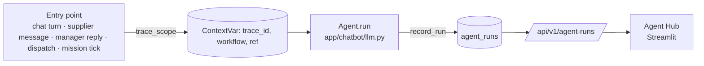
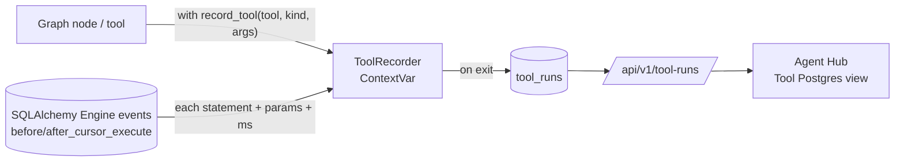

# Agent Tracking — every LLM call, browsable in the Agent Hub

Every call of every LLM agent is recorded in the `agent_runs` table: the rendered system prompt, the input, the output, each schema-retry attempt with its errors, latency and token usage. This covers the Dashboard chat, PO automation, the supplier and manager Telegram agents, and Hub missions. The **Agent Hub** (Streamlit) lets you browse and filter these calls, and follow one flow step by step.

## How it works



- **One place records everything.** `Agent.run` (`app/chatbot/llm.py`) records each call once, whatever the outcome:

  | Status | Meaning |
  |:--|:--|
  | `ok` | valid output |
  | `invalid` | still not valid against the schema after the one retry (the agent raised `AgentOutputError`) |
  | `error` | the model call itself failed |

  Recording uses its own DB session and never raises, so tracking can't break a chat.
- **Traces.** `app/chatbot/tracing.py` keeps the current trace in a `ContextVar`. Every agent call inside a trace shares its `trace_id`:

  | `workflow` | Started by | `ref` |
  |:--|:--|:--|
  | `chat` | `ChatService.stream` (one Dashboard turn: rewrite, route, plan, synthesize, evaluate, PO automation) | `thread_id` |
  | `supplier` | `SupplierChatService.handle_inbound` for a supplier chat | `chat_id`, `supplier_id`, `conversation_id` |
  | `manager` | manager messages and buttons (Telegram or the Hub's Chat Manajer) | `button` / `author` |
  | `supplier_outreach` | `dispatch_queued`, `tick_timeouts` (openings, revision diffs, withdrawals, escalations) | — |
  | `hub_mission` | `missions.tick`, `missions.route_reply` | `supplier_id` |
  | `other` | an agent called outside any scope | — |

  A nested scope keeps the outer trace id. For example, a supplier reply that triggers the manager notice is a single trace. LangGraph nodes and the chat's parallel tool calls inherit the context.
- **Tokens** come from the SAP AI Core response (`usage`) and are summed over the retry attempts.
- **Retention.** The supplier worker deletes rows older than `AGENT_TRACE_RETENTION_DAYS` once a day.

## Postgres tool runs (`tool_runs`)

Every database tool the agents use is recorded too, in the `tool_runs` table, under the **same trace id** as the
agent calls of that turn. So one chat turn can be followed from the LLM's decision down to the SQL it caused.



| `kind` | Recorded where | Examples |
|:--|:--|:--|
| `read` | `registry.run_curated`, `auto_resolve`, `master_parse`, `master_check` | `get_stock_summary`, `resolve_po_request`, `validate_master_data` |
| `sql` | `sql_executor.run_select` (one row per attempt of the text-to-SQL agent) | `query_database` |
| `write` | `automation_graph._execute`, `master_data_graph.master_execute` | `create_po`, `delete_po`, `execute_master_data` |

- **How SQL is captured.** `app/chatbot/tracing.py` listens to SQLAlchemy's `before/after_cursor_execute` events on
  every engine. A statement is collected only while a `record_tool(...)` block is active in the current context,
  so other requests are never mixed in. The text-to-SQL agent runs its query on a raw DB-API cursor (no SQLAlchemy
  event), so `run_select` adds that statement itself.
- **What is kept:** arguments, status, error, latency, row count, the first 20 result rows, and up to 50 SQL
  statements with their parameters and duration.
- **Safe by design:** like agent runs, recording uses its own session and never raises; the same
  `AGENT_TRACE_ENABLED` / retention settings apply.

## Activity log (`hub_audit_log`, page *Riwayat Aktivitas*)

`agent_runs` / `tool_runs` show *how* the agents worked; the activity log shows *what was decided and done*:

- **Manager decisions**: choices on supplier requests (Telegram, Hub card or Chat Manajer), Hub proposals, dashboard-chat proposals (`approve_automation` / `reject_automation`), policy changes, takeovers, drafts, missions.
- **Agent actions**: missions created / finished, dates and prices accepted within the limits, requests escalated to the manager, supplier cancellations and replacement POs, PO confirmations and declines, guardrail blocks and alerts.

Each row has `actor_type` (`MANAGER` / `AGENT` / `SYSTEM`), a readable `summary`, `supplier_id`, `po_number`, `detail` and the `trace_id` of the flow, so the page's detail view lists the LLM calls and tools of that same flow. Written through `app/hub/audit_log.py` (`record`, `agent`). API: `GET /api/v1/activity` (filters `actor_type`, `decisions`, `action`, `ref_type`, `supplier_id`, `po_number`, `q`, `since`, `until`, cursor `before_id`), `GET /api/v1/activity/facets`, `GET /api/v1/activity/{id}`.

## Configuration (`backend/.env`)

```
AGENT_TRACE_ENABLED=true          # false = record nothing
AGENT_TRACE_RETENTION_DAYS=30
```

## Agent Hub (Streamlit)

```bash
pip install -r backend/requirements-streamlit.txt
SIGAP_API_URL=http://localhost:8000/api/v1 streamlit run backend/streamlit_app/agent_hub.py
# or, with Docker:  docker compose --profile tools up --build agent-hub   → http://localhost:8501
```

- **Tampilan (sidebar):** *Agent LLM* (LLM calls) or *Tool Postgres* (database tool runs).
- **Filters (sidebar):**
  - agent or tool (with counts), and for tools the kind (read / SQL agent / write);
  - flow (`workflow`);
  - status;
  - period;
  - text search in input, output, SQL and error (e.g. a supplier name or PO number);
  - trace id;
  - page size and page; optional 10-second auto-refresh.
- **Table:** time (WIB), agent, flow, status, latency, tokens, retries, trace, and an output preview. The metrics above it summarise the filtered set.
- **Detail of a selected call:** the output, the input (shown as a JSON tree), the exact system prompt, every attempt with its schema errors, and the ref ids.
- **Detail of a selected tool run:** every SQL statement (highlighted, with duration and parameters), the arguments, the result preview as a table, and the ref ids.
- **Trace view:** *Tampilkan semua langkah di trace ini* lists every agent call **and** tool run of that turn in time order (e.g. `prompt_rewriter → router → master_data_parser → apply_parsed`), which is the quickest way to see where a flow went wrong.

The hub only talks to the backend API. It has no login, like the rest of the MVP, and the records contain business data and supplier messages. That's why Docker binds it to `127.0.0.1:8501` only.

## API

| Method & path | Purpose |
|:--|:--|
| `GET /agent-runs?agent=&workflow=&status=&trace_id=&q=&since=&until=&limit=&offset=` | `{total, items}`, newest first (oldest first within a `trace_id`); no prompt or attempts |
| `GET /agent-runs/facets` | agents, workflows and statuses with counts |
| `GET /agent-runs/{id}` | full record incl. `system_prompt`, `input`, `attempts` |
| `GET /tool-runs?tool=&kind=&workflow=&status=&trace_id=&q=&since=&until=&limit=&offset=` | `{total, items}`, same ordering; no SQL or result |
| `GET /tool-runs/facets` | tools, kinds, workflows and statuses with counts |
| `GET /tool-runs/{id}` | full record incl. `statements` and `result_preview` |

## Tests

`tests/test_agent_runs.py`:

- one chat turn = one trace with every agent;
- an invalid output is recorded with both attempts;
- a supplier reply is traced with its conversation;
- API filters and detail;
- tracing can be disabled;
- retention purge.

`tests/test_tool_runs.py`:

- a curated tool records its SQL and result rows in the chat trace;
- the text-to-SQL query and a failing query are recorded;
- a master-data turn records `apply_parsed → validate_master_data → execute_master_data` with the INSERTs;
- API list / filter / detail / facets.
