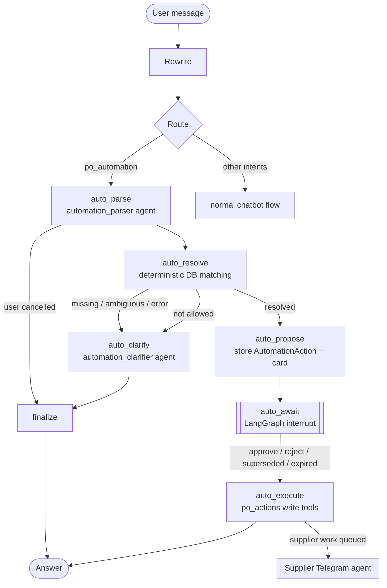

# PO Automation — How It Works

The Dashboard assistant can **create, update and delete Purchase Orders** from a chat message, for example:

- *"Buat PO 50 Ban Luar Karet"* / *"Make a PO for 50 tires"*
- *"Ubah qty PO-202610-0003 jadi 40"*
- *"Hapus PO 123"*

Three rules shape the design:

| Rule | What it means in practice |
|:--|:--|
| **Nothing changes without your click** | Every change is shown as a confirmation card. The database is only touched after you press *Konfirmasi*. |
| **Everything comes from the database** | Materials, suppliers, prices and PO numbers are matched against the database by deterministic tools. The AI never types a price or a total. |
| **Same rules as the UI** | Writes go through the existing `po_service` status machine (submit → approve → issue, stale-planning marking), so the result matches what a person doing it by hand would get. |

Scope: **Purchase Orders only.** Other change requests (stock, planning, master data) still get a pointer to the right page.

---

## Contents

1. [The flow](#1-the-flow)
2. [Clarification](#2-clarification)
3. [Confirmation (interrupt / resume)](#3-confirmation-interrupt--resume)
4. [What each operation does](#4-what-each-operation-does)
5. [Production requests (schedule + multi-PO)](#5-production-requests-schedule--multi-po)
   - [Stock & planning effects of a delete](#5b-stock--planning-effects-of-a-delete)
6. [Agents](#agents)
7. [Tools](#7-tools)
8. [Audit trail](#8-audit-trail)
9. [API](#9-api)
10. [Configuration](#10-configuration)
11. [Testing](#11-testing)
12. [Limitations](#12-limitations)

---

## 1. The flow



The branch lives in `backend/configs/workflows/automation_graph.py` and shares `ChatState` with the main graph.

## 2. Clarification

`auto_parse` turns the message into a request: `operation`, `po_reference`, `items[{material_query, qty}]`, `supplier_query`, `needed_by_date`, `notes`. Then `po_actions.resolve_po_request()` checks it against the database:

| Check | Result when it fails |
|:--|:--|
| Operation known (create / update / delete) | **missing** → "create, change or delete?" |
| Material exists, is PURCHASED and active (fuzzy match like the chatbot tools) | 0 matches → **error**; several → **ambiguous** with options (e.g. *ban* → Ban Luar Karet / Ban Dalam Karet) |
| Quantity given and > 0 | **missing** |
| Supplier (if named) exists and supplies every item | **ambiguous** with the suppliers that do supply it |
| No supplier named | `pick_supplier()` chooses one per item. Items may be split into one PO per supplier, as planning does. |
| PO reference (update/delete) | by number, numeric id ("PO 123"), or partial number |
| Business rules | **refused**, e.g. deleting a PO that already received goods |

`automation_clarifier` writes one short question in the user's language. Its option buttons can only use values from the resolver's candidate list, and anything else is filtered out. The draft is kept in the checkpointed state (`automation_draft`) so the next message continues it. After `automation.max_clarify_rounds` attempts the request is dropped. If the user switches to an unrelated question, the draft is discarded.

- **A new request starts fresh.** The parser sets `is_new_request` when the latest message is a self-contained instruction about another material or PO. Nothing is then carried over from the draft, and the clarification count restarts. As a safety net that doesn't rely on the LLM, a supplier inherited from a draft about *different* materials is dropped (`_drop_stale_supplier`).
- **Supplier references.** `_find_suppliers` accepts a code (`SUP-CPT`), part of a name (`Cipta`), or a label that contains both (`SUP-CPT CV Cipta Logam`, as the rewriter writes it). If the supplier still can't be found, the question offers the active suppliers of the requested material as buttons.
- **Cards in the history.** The rewriter's conversation history includes a one-line summary of each earlier PO proposal card (material, qty, supplier), so follow-ups like "ubah jadi 150" can be resolved.

## 3. Confirmation (interrupt / resume)

When the request is fully resolved:

1. `auto_propose` stores an `AutomationAction` row (status `PROPOSED`, the full proposal JSON, an expiry), and returns a card (`blocks: [text, {type: action}]`, `actions: {id: card}`). The card's tables are rendered from DB values.
2. `auto_await` calls LangGraph `interrupt()`. The thread is paused and the Postgres checkpointer keeps it, so it survives reloads and restarts.
3. The card's buttons call `POST /chat/stream` with `resume: {action_id, decision}`. `ChatService` checks that this exact action is the one pending and resumes with `Command(resume=...)`.
4. A **new message** while a card is pending first resumes it with `superseded`, then handles the new message. A stale card cannot be approved later.
5. Approving after `proposal_ttl_minutes` gives `EXPIRED`.

## 4. What each operation does

| Operation | Allowed when | On approve |
|:--|:--|:--|
| **Create** | Every item resolved | For each supplier group: `create_manual` → `submit` → `approve` (*"Agent MRP (dikonfirmasi pengguna)"*) → `ISSUED`. Then a `CONFIRM_ORDER` supplier conversation is queued and Telegram dispatch starts. |
| **Update** | MANUAL PO in DRAFT / REJECTED | `po_service.update_manual` (quantities, extra lines priced from the PO's supplier, needed-by date, notes) |
| **Delete**, PO never sent | DRAFT, PENDING_APPROVAL, APPROVED, REJECTED, CANCELLED | Hard delete right away |
| **Delete**, PO already issued | ISSUED | A `CANCEL_ORDER` conversation is queued and the confirmation becomes `CANCEL_PENDING`. The PO is **cancelled** (status `CANCELLED`, *Dibatalkan*, kept on record) **only after the supplier agrees** on Telegram. If they refuse, the manager is notified. |
| **Produce** (production request) | finished product + qty + date resolved, complete BOM | One transaction: a new MPS schedule (`schedule_service.create_schedule`, which recalculates allocated stock and marks planning runs stale), then one ISSUED PO per chosen supplier (`needed_by_date` = the date, notes = batch code) + a queued `CONFIRM_ORDER` conversation each. Refused if stock, open POs or prices changed since the card was shown. |
| **Delete**, goods received | PARTIALLY_RECEIVED, RECEIVED | Refused (received stock needs a return process) |

All writes of one approval run inside `po_actions.write_session()`. It is a single transaction, and the `commit()` calls inside `po_service` only release savepoints, so a failure halfway leaves nothing behind. Every update or delete first checks that the PO still matches the snapshot shown on the card.

## 5. Production requests (schedule + multi-PO)

*"Saya membutuhkan 100 sepeda gunung, besok harus ada materialnya"* → `operation=produce` (items = finished products, `needed_by_date` = production date). `po_actions._resolve_produce`:

1. **Requirement.** `allocation_service.requirement` explodes the BOM. An incomplete BOM is an error.
2. **Stock check per BUY material:**
   - `available_after = on_hand − allocated − requirement`;
   - `incoming_in_time` = open PO lines expected by the date (supplier's promised date, else the line's needed-by date; undated or late lines don't count);
   - `shortfall = max(0, safety_stock − (available_after + incoming_in_time))`, the same rule as the MRP run, ordering back up to the safety stock.
3. **Suppliers, cross-checked over all short materials** (`assign_suppliers`):
   - Only links that arrive in time are candidates. If none can, the fastest link is used, with a *paling cepat tiba …* warning.
   - A greedy cover then chooses the supplier that can supply the most remaining materials. Ties go to: no MOQ shortfall, preferred links, lower cost, shorter lead time.
   - A supplier that sells several of the materials gets them on **one PO**. The card shows the extra cost compared with cheapest-per-material and how many POs it saved.
   - The order qty is `max(shortfall, moq)`.
   - `create` requests without a named supplier use the same consolidation.
4. **Card.** A material check table, plus one table per supplier PO. With enough stock, it proposes the schedule only.

**Pages that change on approval** (all derived, no manual sync):

- MPS & Planning: the new batch, and DRAFT runs marked stale;
- Inventory / Materials: `allocated` from the new schedule, and `on_order` from the new POs;
- Purchase Orders: the ISSUED POs;
- Hub Supplier: the queued Telegram conversations;
- Dashboard chat: the result message with the batch code and PO numbers.

## 5b. Stock & planning effects of a delete

`po_service.delete_po()`:

- **On-order stock**: `on_order` is derived from PO lines in the counted statuses (`planning_service.COUNTED`), so removing the PO removes its quantity automatically.
- **Planning**: all DRAFT planning runs are marked stale, because their on-order figures changed. The run the PO came from (for PLANNING POs) is marked stale too, so it is visible that the shortfall needs a new run.
- **Received goods**: refused, so physical stock and stock movements are never touched.
- **History**: supplier conversations and change requests keep a `po_snapshot` and their `po_id` becomes NULL (`ON DELETE SET NULL`). The supplier confirmation row is removed with the PO (`CASCADE`).
- **PO numbers are never reused.** `_next_po_number()` now takes the highest number used this month (including numbers that only survive in conversations or audit rows) + 1, instead of counting rows. Counting rows breaks after a delete.

## Agents

Each agent has `configs/agent/<name>.yaml` (prompt, generation settings) and `configs/schema/<name>.schema.json` (strict JSON Schema, validated with one self-correction retry).

| Agent | Output | Used in |
|:--|:--|:--|
| `router` (updated) | `intent` now includes `po_automation` | Route |
| `automation_parser` | `operation` (create / update / delete / **produce** / none), `po_reference`, `items[{material_query, qty}]`, `supplier_query`, `needed_by_date`, `notes`, `is_new_request`, `user_cancelled`, `reason` | auto_parse |
| `automation_clarifier` | `question_text`, `options[{label, value}]` | auto_clarify |

## 7. Tools

`backend/configs/tools/po_actions.py` (write tools, `WRITE_TOOLS`) is kept separate from the read-only `TOOL_CATALOG` the retrieval planner sees. Only deterministic workflow nodes call them.

| Tool | Purpose |
|:--|:--|
| `resolve_po_request` | read-only matching + proposal |
| `pick_supplier` | supplier choice policy, also used for re-sourcing |
| `create_and_issue_po` | create → submit → approve → issue |
| `update_draft_po` | edit DRAFT/REJECTED manual PO |
| `delete_po` | hard delete with stock/planning revert |
| `request_po_cancellation` | start supplier cancellation for an ISSUED PO |
| `queue_conversation` | queue a supplier Telegram conversation |

The read tool `get_po_supplier_status` (in `curated.py`) lets the normal chatbot answer *"sudah dikonfirmasi supplier belum?"*.

## 8. Audit trail

Table `automation_actions`: `id`, `thread_id`, `operation`, `status` (`PROPOSED`, `REJECTED`, `SUPERSEDED`, `EXPIRED`, `EXECUTED`, `AWAITING_SUPPLIER`, `FAILED`), `proposal` (exact JSON the user approved), `result` (created POs, errors, later supplier outcome), `po_id`/`po_number`, timestamps. Supplier outcomes (confirmed, cancellation agreed, refused, re-sourced) are written back to `result.supplier_outcome`.

## 9. API

`POST /api/v1/chat/stream` (and `POST /api/v1/chat`) accept exactly one of:

```json
{ "thread_id": "3f2c9a7e1b4d", "message": "Buat PO 50 Ban Luar Karet" }
{ "thread_id": "3f2c9a7e1b4d", "resume": { "action_id": "9b1f…(32 hex)", "decision": "approve" } }
```

`final` for a proposal contains `actions`:

```json
{
  "type": "final",
  "blocks": [{ "type": "text", "text": "Saya siapkan PO berikut…" }, { "type": "action", "actionId": "9b1f…" }],
  "actions": { "9b1f…": { "kind": "create", "title": "Buat & terbitkan PO", "approveLabel": "Konfirmasi & terbitkan",
                          "status": "pending", "tables": [{ "title": "SUP-KRT …", "columns": ["SKU", "…"], "rows": [["RM-RUB-01", "…"]] }] } },
  "meta": { "intent": "po_automation", "evaluated": false, "automation": { "action_id": "9b1f…", "status": "PROPOSED" } }
}
```

After a resume, `final.action_updates` carries the card's new status (`approved` / `rejected` / `expired` / `failed`). A clarification adds `{ "type": "options", "options": [{label, value}] }`, which the Dashboard shows as quick-reply chips. `GET /chat/{thread_id}/history` returns `actions` with their current status.

## 10. Configuration

`backend/configs/models.yaml`:

```yaml
automation:
  proposal_ttl_minutes: 30
  max_clarify_rounds: 3
  actor: "Agent MRP (dikonfirmasi pengguna)"   # decided_by on POs approved through the card
```

## 11. Testing

`backend/tests/test_automation_graph.py` (scripted fake LLMs, real test DB) covers:

- clarify on ambiguous material → proposal → approve → ISSUED PO + queued supplier conversation
- reject
- supersede by a new message, and a stale resume being refused
- delete DRAFT (immediate)
- delete ISSUED (supplier cancellation)
- delete RECEIVED (refused)
- update DRAFT, and update ISSUED (refused)
- user cancelling the request

```bash
docker compose exec backend pytest -q tests/test_automation_graph.py
```

## 12. Limitations

- An ISSUED PO cannot be edited from the chat. Delete it (with supplier consent) and create a new one. Supplier-initiated revisions are handled by the Telegram agent, see [`SUPPLIER_TELEGRAM.md`](SUPPLIER_TELEGRAM.md#5-revision-flow).
- Changing the supplier of an existing PO is not supported. Use delete + create.
- There is no user authentication yet (MVP), so `decided_by` records the agent, not a named person.
