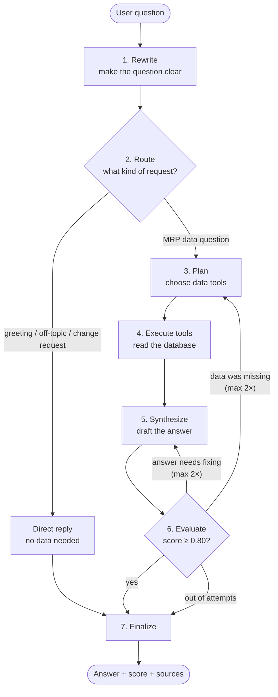
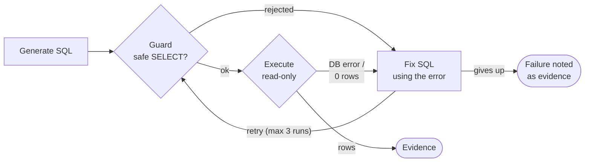
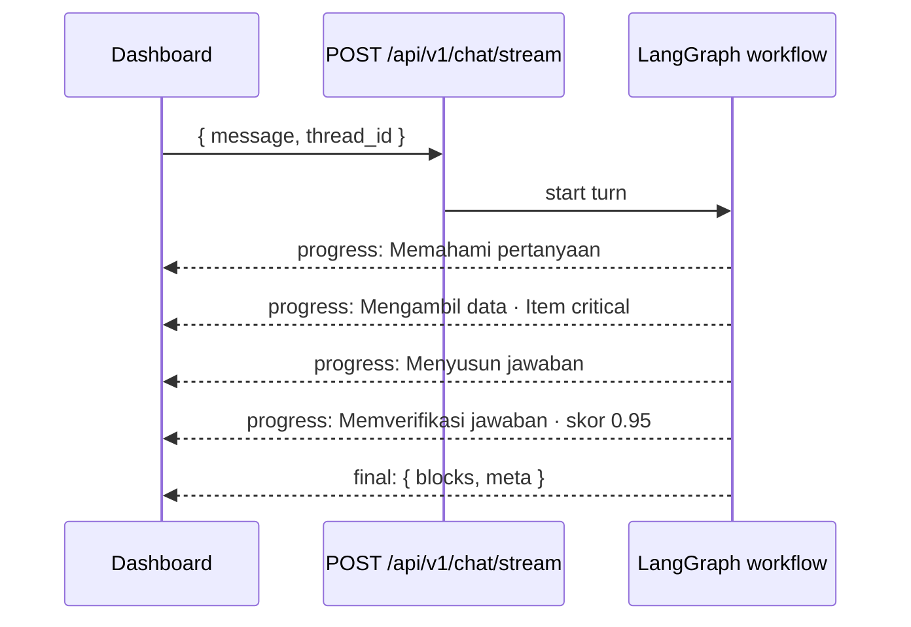

# MRP Chatbot — How It Works

The **Agentic MRP Assistant** on the Dashboard answers questions about your MRP data in plain language, in Indonesian or English:

- *"Ringkas stok saat ini untuk setiap item"*
- *"Which items are critical?"*
- *"Supplier apa saja untuk material Pedal Sepeda?"*
- *"Berapa kebutuhan Ban Luar Karet untuk 50 unit Sepeda Gunung?"*

Three promises shape the whole design:

| Promise | What it means in practice |
|:--|:--|
| **Read-only** | The chatbot can never create, change, or delete data. Requests like "buat PO" get a polite pointer to the right page. |
| **Grounded** | Every fact comes from the database. Tables are built from real query results, never typed by the AI. |
| **Verified** | Before you see an answer, a second AI model grades it. Answers scoring below **0.80** are improved automatically or clearly marked as unverified. |

---

## Contents

1. [Quick start](#1-quick-start)
2. [The big picture](#2-the-big-picture)
3. [Step by step: what happens when you ask a question](#3-step-by-step-what-happens-when-you-ask-a-question)
4. [How the chatbot gets data](#4-how-the-chatbot-gets-data)
5. [The quality gate (scoring)](#5-the-quality-gate-scoring)
6. [Conversation memory and live progress](#6-conversation-memory-and-live-progress)
7. [Where everything lives](#7-where-everything-lives)
8. [Configuration and common changes](#8-configuration-and-common-changes)
9. [API reference](#9-api-reference)
10. [Testing and evaluation](#10-testing-and-evaluation)
11. [Security](#11-security)
12. [Troubleshooting](#12-troubleshooting)

---

## 1. Quick start

```bash
cp backend/.env.example backend/.env     # fill in the AICORE_* values (SAP AI Core credentials)
docker compose up --build
```

Open <http://localhost:8080> → **Dashboard**, then click one of the quick prompts or type a question.

- Without `AICORE_*` credentials the rest of the app works normally; the chatbot replies that it is not configured (HTTP 503).
- The Docker database is seeded with demo data and two demo production schedules, so questions like "which items are critical?" have real answers immediately.

Running without Docker: see the root `README.md`. Set the same `AICORE_*` values in `backend/.env`.

---

## 2. The big picture

The chatbot is a **LangGraph workflow**: a small state machine where each box is a step, and arrows decide what runs next.



**In one sentence:** the chatbot understands the question, fetches exactly the data it needs, writes an answer using only that data, has an independent judge check it, and loops to fix problems before showing you the result.

Two AI models are used on purpose:

| Role | Model (SAP AI Core) | Used for |
|:--|:--|:--|
| **Generator** | `gpt-5.4` | rewriting, routing, planning, writing SQL, writing answers |
| **Judge** | `anthropic--claude-4.6-sonnet` | grading answers |

Using a *different* model as the judge avoids an AI grading its own homework.

---

## 3. Step by step: what happens when you ask a question

We follow one example: **"item apa yang critical?"**

### Step 1 — Rewrite
Turns the message into one clear, standalone English question and detects your language.
It also resolves follow-ups: if you previously asked about Ban Luar Karet and now ask *"siapa yang termurah?"*, it becomes *"Who is the cheapest supplier for Ban Luar Karet?"*.

> `"item apa yang critical?"` → `"Which items have critical stock?"` (language: `id`)

### Step 2 — Route
Classifies the request into one of four intents:

| Intent | Example | What happens |
|:--|:--|:--|
| `mrp_query` | "stok Pedal berapa?" | goes to data retrieval (steps 3–7) |
| `smalltalk` | "halo, bisa bantu apa?" | friendly reply explaining capabilities |
| `write_request` | "buatkan PO untuk Ban" | explains it is read-only, points to the right page |
| `out_of_scope` | "cuaca hari ini?" | politely declines |

### Step 3 — Plan
Picks 1–4 **tools** that together fetch everything the question needs. Curated tools are preferred because they already apply the business rules; free-form SQL is the fallback.

> Plan: `get_critical_items(include_warning = false)`

### Step 4 — Execute tools
Runs the planned tools in parallel against a **read-only** database connection. Each result becomes a numbered piece of **evidence** (`E1`, `E2`, …) containing the rows, row count, and any SQL used.

> `E1`: 2 rows — RM-RUB-01 Ban Luar Karet (available −20), RM-SBR-01 Rangka Besi Dudukan Jok (available 0)

### Step 5 — Synthesize
Writes the answer **only from the evidence**, in your language. It must:
- copy numbers exactly from the evidence,
- list every factual claim together with the evidence that supports it,
- say plainly when the data is insufficient instead of guessing.

For tables it only says *"show evidence E1, columns sku/name/available/status"* — the server builds the rows from the real data.

### Step 6 — Evaluate
Grades the draft (details in [section 5](#5-the-quality-gate-scoring)) and decides what to do next:

| Result | Next step |
|:--|:--|
| Score ≥ 0.80 and faithfulness ≥ 0.70 | ✅ finalize |
| Judge says *data was missing* (and fewer than 2 retrieval rounds so far) | 🔁 back to **Plan**, with the judge's note on what to fetch |
| Other problem (and fewer than 2 revisions so far) | ✏️ back to **Synthesize**, with the judge's critique |
| Out of attempts | ⚠️ finalize with the **best-scoring** draft plus a "not verified" notice |

### Step 7 — Finalize
Renders the answer into blocks the Dashboard understands (text, table, notice), attaches the score, metrics, and sources, and saves the turn to conversation memory.

---

## 4. How the chatbot gets data

### 4.1 Curated tools (preferred)

These reuse the same backend services as the UI pages, so numbers always match what users see elsewhere.

| Tool | Answers questions like | Reuses |
|:--|:--|:--|
| `get_stock_summary` | "summarize stock per item", "which purchased items are SAFE?" | `inventory_service.list_inventory` |
| `get_critical_items` | "what is critical?", "critical and warning items" | same, filtered and sorted by severity |
| `find_materials` | "is there a material called 'busa'?" | fuzzy SKU / name search |
| `get_material_suppliers` | "suppliers for material A", "cheapest / fastest supplier" | `master_service.list_links` |
| `list_suppliers` | "what suppliers do we have?", "payment terms of CV Cipta Logam" | `master_service.list_suppliers` |
| `get_open_purchase_orders` | "which POs are not received yet?" | purchase orders with open statuses |
| `get_latest_planning_run` | "what did the last planning run say?" | `planning_service.summarize` |
| `get_bom` | "components of Sepeda Gunung", "requirement for 50 units" | `bom_service.build_tree` |
| `get_production_schedules` | "what is scheduled next week?" | schedules table |

Material names are matched **fuzzily** (exact SKU → partial name → all words → close spelling), so "pedall sepeda" still finds *Pedal Sepeda*.

### 4.2 `query_database` — the SQL agent (fallback)

For questions no curated tool covers (rankings, aggregations, stock-movement history…), the planner calls `query_database`, which is its own small LangGraph workflow:



- **Generate** writes one PostgreSQL `SELECT`, using a catalog of allowed views and tables plus a glossary (Stok Fisik = `on_hand`, Tersedia = `available`, …).
- **Guard** parses the SQL (with `sqlglot`) and rejects anything that is not a single, safe `SELECT` over allowed relations. It also forces `LIMIT ≤ 200`.
- **Execute** runs it inside a `READ ONLY` transaction with a 5-second timeout.
- **Fix** reads the error (or the empty result) and rewrites the query. It can give up if the data simply doesn't exist.
- A failure is not hidden: it becomes evidence with an error, so the judge sees that context was missing.

### 4.3 The semantic layer (database views)

Key MRP numbers such as *available*, *on order*, *shortfall*, and *status* are **calculated in Python**, not stored as columns. An AI writing raw SQL would easily get "critical" wrong. So the backend creates read-only **views** that apply the exact same rules:

| View | Contains |
|:--|:--|
| `chat_inventory_status_v` | stock per item with `available`, `on_order`, `shortfall`, `status` |
| `chat_material_suppliers_v` | supplier offers per material with `is_cheapest`, `is_fastest` |
| `chat_purchase_order_items_v` | every PO line with supplier, quantities, and `is_open` |
| `chat_latest_planning_lines_v` | lines of the most recent planning run |
| `chat_schedules_v` | production batches with product and line names |
| `chat_bom_v` | direct parent → component BOM links |

Status rule (same as the Inventory page): **CRITICAL** if available ≤ 0, **WARNING** if available < safety stock, otherwise **SAFE**.

The views are re-created automatically whenever tables are created (app start, seed script, tests). A test checks that the view and the Inventory service always agree.

---

## 5. The quality gate (scoring)

Every data answer is scored on four metrics, each from 0 to 1:

| Metric | Question it answers | Who measures | Weight |
|:--|:--|:--|--:|
| **Faithfulness** | Is every claim supported by the evidence? *(supported claims ÷ all claims)* | Judge model, claim by claim | **0.40** |
| **Answer relevance** | Does it actually answer what was asked? | Judge model | **0.25** |
| **Numeric grounding** | Does every number in the text appear in the evidence? | Code (deterministic) | **0.20** |
| **Completeness** | Are all parts of the question answered and backed by data? | Judge model | **0.15** |

```
score = 0.40·faithfulness + 0.25·relevance + 0.20·numeric_grounding + 0.15·completeness
```

**An answer passes only if both are true:**
1. `score ≥ 0.80`
2. `faithfulness ≥ 0.70` — a safety floor, so a fluent, relevant answer can't pass while still inventing facts.

**Worked example:** faithfulness 0.9, relevance 0.8, numeric 1.0, completeness 0.6
→ 0.36 + 0.20 + 0.20 + 0.09 = **0.85** ✅ passes.

**Numeric grounding in detail.** The code extracts the numbers from the answer text (it ignores SKUs like `RM-PDL-01`, dates, and evidence ids) and accepts a number if it matches:
- a value in the evidence rows (both `3.400.000` and `3,400,000` notations are understood),
- a row count or the count of a category (e.g. "2 items are critical"),
- the sum of a numeric column,
- or a number the user typed in the question.

Unmatched numbers are reported back to the writer in the next revision.

What you see in the UI:
- **Terverifikasi · skor 0.92** (green) — passed. Hover to see each metric.
- **Belum terverifikasi** (amber) plus a notice — the best attempt still scored below 0.80; double-check the figures on the related page.

All weights, thresholds, and attempt limits are configurable (see [section 8](#8-configuration-and-common-changes)).

---

## 6. Conversation memory and live progress

**Memory.** Each conversation has a `thread_id` kept in the browser. The workflow saves its state to Postgres with LangGraph's `PostgresSaver` (tables named `checkpoint*`). That gives you:
- follow-up questions ("and who is the cheapest?") that understand earlier turns,
- conversation history that survives a page reload or backend restart,
- **Percakapan baru** to start a fresh thread.

**Live progress.** Answers are streamed with Server-Sent Events (SSE). While the chatbot works, the Dashboard shows each step as it happens:



---

## 7. Where everything lives

```
backend/
├── app/chatbot/                  services & agent initiation
│   ├── service.py                ChatService: runs turns, streaming, history, Postgres checkpointer
│   ├── llm.py                    SAP AI Core clients + Agent (schema-validated calls, one retry)
│   ├── config_loader.py          reads models.yaml, agent YAMLs and JSON Schemas
│   ├── evidence.py               evidence format + table rendering from real rows
│   ├── scoring.py                numeric grounding + weighted quality gate
│   ├── progress.py               progress events for the live stream
│   ├── schema_catalog.py         allowed relations + descriptions for the SQL agent
│   ├── semantic_views.py         the chat_*_v database views
│   └── db.py                     read-only database engine
├── configs/
│   ├── models.yaml               models, agent registry, chatbot settings (threshold, weights…)
│   ├── agent/<agent>.yaml        prompt + generation settings, one per agent
│   ├── schema/<agent>.schema.json  required output structure, one per agent
│   ├── tools/                    data tools
│   │   ├── curated.py            the curated tools (section 4.1)
│   │   ├── registry.py           tool catalog for the planner + tool dispatcher
│   │   ├── sql_guard.py          SQL safety checks
│   │   └── sql_executor.py       read-only SQL execution
│   └── workflows/                LangGraph workflows
│       ├── chat_graph.py         main workflow (section 2)
│       └── sql_agent_graph.py    query_database workflow (section 4.2)
├── app/api/v1/endpoints/chat.py  HTTP + SSE endpoints
├── scripts/eval_chatbot.py       offline evaluation with real models
└── tests/test_chat_*.py          chatbot tests
frontend/src/
├── pages/DashboardPage.jsx       chat UI (progress, tables, score badge, sources)
└── services/chatService.js       SSE client + thread id
```

### The eight agents

Each agent is one LLM call with its own prompt (`configs/agent/`) and output contract (`configs/schema/`):

| Agent | Step | Model | Output |
|:--|:--|:--|:--|
| `prompt_rewriter` | Rewrite | generator | `rewritten_query`, `language`, `is_follow_up` |
| `router` | Route | generator | `intent`, `reason` |
| `retrieval_planner` | Plan | generator | list of tool `calls` |
| `sql_generator` | SQL agent | generator | `sql`, `tables_used`, `rationale` |
| `sql_fixer` | SQL agent | generator | corrected `sql`, `diagnosis`, `give_up` |
| `synthesizer` | Synthesize | generator | `blocks`, `claims`, `insufficient_data` |
| `evaluator` | Evaluate | **judge** | metric scores, `claim_verdicts`, `failure_type`, `critique` |
| `direct_responder` | Direct reply | generator | `blocks` |

**Output contracts.** Every response is validated against the agent's JSON Schema. If it doesn't match, the model is shown the errors and asked once to correct itself; a second failure stops the turn with a clear error instead of passing on malformed data.

---

## 8. Configuration and common changes

Everything tunable lives in `backend/configs/models.yaml`:

```yaml
SAP_LLM:
  models:
    generator: { provider: sap_openai,  model_name: gpt-5.4 }
    judge:     { provider: sap_bedrock, model_name: anthropic--claude-4.6-sonnet }
chatbot:
  evaluation:
    threshold: 0.8            # minimum weighted score
    faithfulness_floor: 0.7   # minimum faithfulness, regardless of score
    weights: { faithfulness: 0.40, answer_relevance: 0.25, numeric_grounding: 0.20, completeness: 0.15 }
    max_retrieve_attempts: 2
    max_revise_attempts: 2
  sql_agent: { max_attempts: 3, row_limit: 200, statement_timeout_ms: 5000 }
```

| I want to… | Do this |
|:--|:--|
| Change a model | Edit `model_name` under `SAP_LLM.models` (must be deployed in your AI Core resource group). |
| Make the gate stricter or looser | Change `threshold`, `faithfulness_floor`, or `weights`. |
| Improve an agent's behaviour | Edit its prompt in `configs/agent/<agent>.yaml`. |
| Change what an agent returns | Edit `configs/schema/<agent>.schema.json`, then update the code that reads it and the test fixture in `tests/test_chat_contracts.py`. |
| Add a curated tool | 1) write the function in `configs/tools/curated.py` and add it to `CURATED`; 2) describe it in `TOOL_CATALOG` in `configs/tools/registry.py`; 3) add its name (and any new argument) to `configs/schema/retrieval_planner.schema.json`. |
| Let the SQL agent use another table | Add it to `BASE_TABLES` (or a new view to `VIEW_CATALOG`) in `app/chatbot/schema_catalog.py`. |

Environment variables (`backend/.env`, see `backend/.env.example`):

| Variable | Purpose |
|:--|:--|
| `AICORE_AUTH_URL`, `AICORE_CLIENT_ID`, `AICORE_CLIENT_SECRET`, `AICORE_BASE_URL`, `AICORE_RESOURCE_GROUP` | SAP AI Core credentials (from the keybroker). `/oauth/token` and `/v2` are appended automatically. |
| `CHAT_DATABASE_URL` | Optional read-only database role for the chatbot. Defaults to `DATABASE_URL` (still in read-only transactions). |

---

## 9. API reference

| Method & path | Purpose |
|:--|:--|
| `POST /api/v1/chat/stream` | Ask a question; returns an SSE stream of `progress` events, then one `final` (or `error`) event. |
| `POST /api/v1/chat` | Same, without streaming; returns the final event as JSON. |
| `GET /api/v1/chat/{thread_id}/history` | Messages of a conversation (used to restore the UI after reload). |
| `GET /api/v1/chat/health` | `{ "configured": true/false }`, i.e. whether the AI Core credentials are set. |

Request body: `{ "message": "item apa yang critical?", "thread_id": "3f2c9a7e1b4d" }` (thread id: 8–64 letters, digits, `-` or `_`).

`final` event (shortened):

```json
{
  "type": "final",
  "blocks": [
    { "type": "text", "text": "Ada 2 item dengan stok critical: ..." },
    { "type": "table", "columns": ["SKU", "Nama", "Tersedia", "Status"], "rows": [["RM-RUB-01", "Ban Luar Karet", "-20", "CRITICAL"]] }
  ],
  "meta": {
    "intent": "mrp_query", "score": 0.95, "passed": true, "threshold": 0.8,
    "metrics": { "faithfulness": 1.0, "answer_relevance": 0.9, "numeric_grounding": 1.0, "completeness": 0.85 },
    "attempts": { "retrieve": 1, "revise": 0 },
    "sources": [{ "id": "E1", "tool": "get_critical_items", "row_count": 2, "sql": null, "error": null }]
  }
}
```

Try it from a terminal:

```bash
curl -N -X POST http://localhost:8080/api/v1/chat/stream -H 'content-type: application/json' -d '{"message":"item apa yang critical?","thread_id":"curltest01"}'
```

---

## 10. Testing and evaluation

**Automated tests** use scripted fake models, so they run without AI credentials (but need a test Postgres database):

```bash
docker compose exec backend pytest -q tests/test_chat_tools.py tests/test_chat_contracts.py tests/test_chat_graph.py
```

They cover the SQL guard, the views versus the services, every curated tool, schema contracts and the retry, the scoring maths, and every workflow path (pass, revise, re-fetch, out of attempts, SQL repair, follow-up memory, SSE, Postgres memory).

**Offline evaluation with the real models** runs 14 golden questions (`backend/tests/chatbot_eval/golden.yaml`) and checks intent, expected facts, and the quality gate:

```bash
docker compose exec backend python -m scripts.seed --reset --demo-schedules
docker compose exec backend python -m scripts.eval_chatbot --out /tmp/report.json
```

It prints PASS/FAIL per question plus the average of each metric and the gate pass rate. Re-run it after changing prompts, models, or thresholds.

---

## 11. Security

The chatbot is read-only by **three independent layers**:

1. **Database role.** In Docker, the chatbot connects as `mrp_chat_ro`, which only has `SELECT` rights.
2. **Read-only transactions.** Every chatbot transaction starts with `SET TRANSACTION READ ONLY`, even with a normal database user.
3. **SQL guard.** AI-written SQL must be a single `SELECT` on allow-listed views and tables. Writes, DDL, `SELECT INTO`, row locks, system catalogs, and functions such as `pg_sleep` or `dblink` are rejected before reaching the database.

Also:
- AI-generated SQL gets a 5-second timeout and at most 200 rows.
- Conversation history is stored in the application database; don't put secrets in chat messages.
- Credentials belong in `backend/.env` (git-ignored), never in the tracked root `.env`.

---

## 12. Troubleshooting

| Symptom | Cause / fix |
|:--|:--|
| "Chatbot belum dikonfigurasi…" (HTTP 503) | `AICORE_*` values are missing. Fill them in `backend/.env` and restart the backend. |
| Chat says "Not Found" when running `npm run dev` | `frontend/.env` points `VITE_API_URL` at a deployed backend without the chatbot. Use `VITE_API_URL=/api/v1` locally. |
| "No deployment found with model_name …" | The model name in `models.yaml` isn't deployed in your AI Core resource group. Check the deployment list. |
| Many answers show **Belum terverifikasi** | Look at the metrics on hover. Low *numeric grounding* means invented numbers (tighten the `synthesizer` prompt); low *completeness* usually means a tool is missing for that kind of question. |
| Progress steps appear all at once | A proxy is buffering the stream. The provided nginx config disables buffering for `/api/`; do the same for any other proxy. |
| Answers about stock look outdated | Stock values are live; planning-run data is a snapshot. Re-run planning on the MPS page. |
