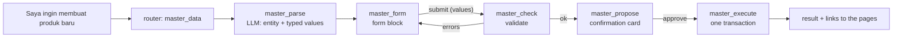

# Master data from the chat: new products, materials and suppliers

From the Dashboard chat the user can add a **finished product** (with its BOM), a **purchased material** (with its
suppliers) or a **supplier** (with the materials it supplies). Nothing is written until the user has filled a form
in the chat **and** confirmed a summary card.

| Step | Code | What happens |
|:--|:--|:--|
| Understand | `master_parse` (`configs/workflows/master_data_graph.py`), agent `master_data_parser` | Which entity, and any fields/items already typed (e.g. "pakai 2 Pedal Sepeda dan 1 Rangka Titanium"). |
| Match | `master_actions.apply_parsed` | Typed names are matched against the DB: 1 match → selected; 0 → a pre-filled **new** material/supplier row; several → the user must pick. Only matches containing every typed word count, so a merely similar name becomes a new item instead of silently reusing another one. |
| Form | `master_actions.form_block` → `frontend/src/features/chat/ChatForm.jsx` | Required fields are marked `*`; dropdowns list existing records plus **"+ Material baru" / "+ Supplier baru"**, which open inline fields (SKU, name, unit, initial stock 0 …). The browser checks required fields; the user may also keep typing in the chat, which updates the same draft. |
| Validate | `master_actions.validate` | Existing Pydantic schemas (`ProductCreate`, `MaterialCreate`, `SupplierCreate`, `MaterialSupplierCreate`) + DB rules: unique SKU/code (in the DB and inside the form), BOM child not a finished product, qty > 0, no duplicate rows, supplier links only for purchased materials, active records only. Errors come back inline in the form. |
| Confirm | `master_propose` | A card lists everything that will be created (product, new materials with stock, new suppliers, BOM lines, supplier links) plus warnings (product without BOM cannot be scheduled; material without supplier cannot be ordered). |
| Execute | `master_actions.execute` inside `po_actions.write_session()` | Re-validates, then calls the **existing** services (`master_service`, `bom_service`, `inventory_service`) in one transaction. New materials get an inventory row (initial / safety stock, default 0). |

Each pause (form, card) is a LangGraph `interrupt()`; the frontend answers with
`POST /chat/stream {resume: {action_id, decision: submit|approve|reject, values?}}`.
Proposals are stored in `automation_actions` (`NEW_PRODUCT`, `NEW_MATERIAL`, `NEW_SUPPLIER`). Every database step is
traced in `tool_runs` (see [AGENT_TRACKING.md](AGENT_TRACKING.md)).

Tests: `backend/tests/test_master_data_graph.py`.
