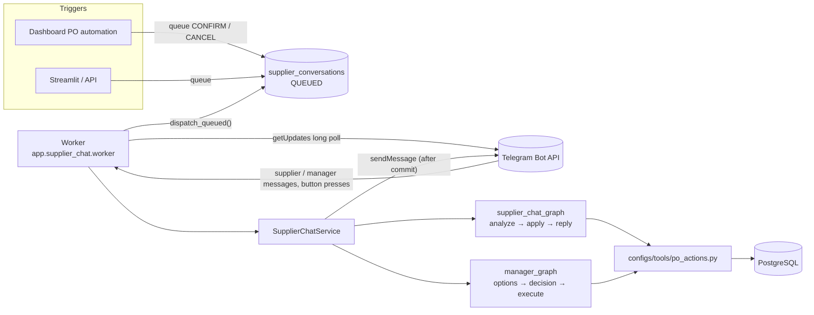
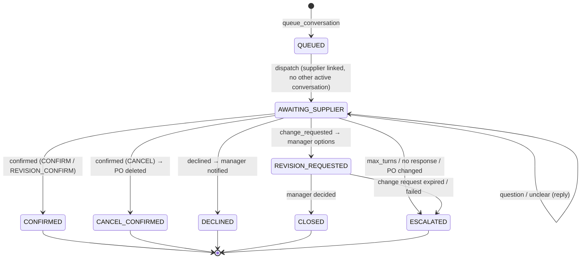
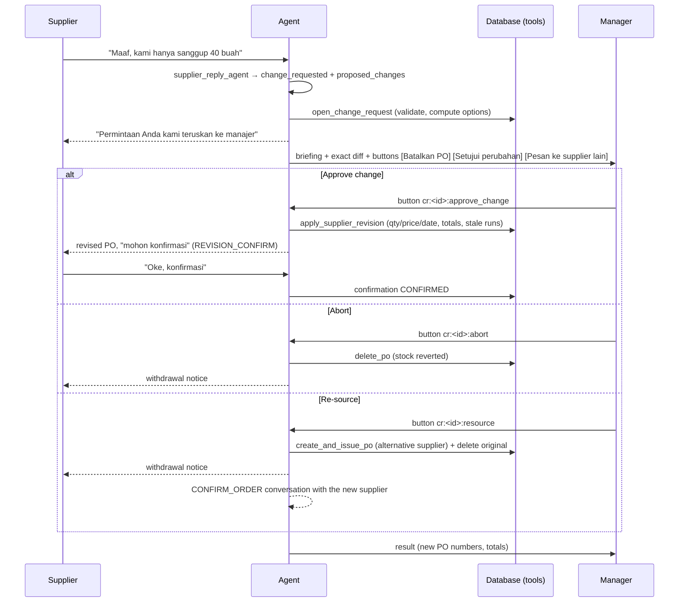

# Supplier Telegram Agent — How It Works

A background agent talks to suppliers on **Telegram** about purchase orders. It keeps the conversation going until it gets a clear answer, then updates the database through tools. It handles four situations:

| Situation | The agent… | When the supplier answers |
|:--|:--|:--|
| A PO was issued (e.g. by [PO automation](AUTOMATION.md)) | asks the supplier to **confirm** the order and its delivery date | confirmed → PO confirmation `CONFIRMED` (with promised date / supplier reference) |
| A user asked to delete an ISSUED PO | asks the supplier to agree to the **cancellation** | agreed → PO **deleted** and stock reverted; refused → **manager notified** |
| The supplier asks to **revise** a PO (qty, price, delivery date), during a chat or in a new chat later | sends the manager the options **abort / approve change / re-source** | manager approves → PO updated and sent back for supplier confirmation; re-source → new PO to another supplier |
| No response, unclear answers, a refusal | sends reminders, then escalates to the manager with the full context | — |

There is no frontend for this yet. It is tested with the **Telegram Lab** Streamlit app (section 9).

---

## Contents

1. [Architecture](#1-architecture)
2. [Transports: sandbox vs. telegram](#2-transports-sandbox-vs-telegram)
3. [Linking suppliers and the manager](#3-linking-suppliers-and-the-manager)
4. [Conversation lifecycle](#4-conversation-lifecycle)
5. [Revision flow](#5-revision-flow)
6. [Decision mapping](#6-decision-mapping)
7. [Agents](#agents)
8. [Data model](#8-data-model)
9. [Telegram Lab (Streamlit)](#9-telegram-lab-streamlit)
10. [API](#10-api)
11. [Running the worker](#11-running-the-worker)
12. [Configuration](#12-configuration)
13. [Security](#13-security)
14. [Testing](#14-testing)
15. [Troubleshooting](#15-troubleshooting)

---

## 1. Architecture



- **`app/supplier_chat/service.py`**: `SupplierChatService` handles links, dispatch (one active conversation per supplier), inbound routing, manager notices, reminders and timeouts.
- **`configs/workflows/supplier_chat_graph.py`**: one supplier reply: `load_context → analyze (LLM) → apply_decision (tools) → escalate | present_revision → deliver`.
- **`configs/workflows/manager_graph.py`**: change-request options, button / free-text decisions, execution.
- **`configs/tools/po_actions.py`**: every DB write. All business rules live here and in `po_service`.
- The DB is the source of truth. The graphs keep no state between messages, so the worker can restart at any time.
- **Messages are sent only after the transaction that produced them commits.** If a write fails, nothing is sent.

## 2. Transports: sandbox vs. telegram

| `TELEGRAM_MODE` | Delivery | Inbound | Use for |
|:--|:--|:--|:--|
| `sandbox` (default) | stored in `supplier_messages` only | `POST /supplier-chat/sandbox/inbound` and `/sandbox/manager` (Telegram Lab) | local testing without a bot token |
| `telegram` | Bot API `sendMessage` (inline keyboards for manager options) | worker long-polls `getUpdates` (messages + `callback_query`) | real suppliers |

Both use exactly the same service and workflows. Only `transport.py` differs (`SandboxTransport` / `TelegramTransport`).

## 3. Linking suppliers and the manager

- Each supplier gets a random **link token** (`supplier_telegram_links`). The deep link `https://t.me/<TELEGRAM_BOT_USERNAME>?start=<token>` opens the bot. When the supplier presses *Start*, the bot receives `/start <token>` and maps that chat to the supplier. A token, not the supplier code, is used so nobody can impersonate a supplier by guessing a code.
- One chat maps to one supplier. Re-linking a chat moves it.
- Messages from unknown chats are ignored.
- The **manager** chat comes from `TELEGRAM_MANAGER_CHAT_ID`. In sandbox mode a fixed simulated chat is used. Option buttons are accepted **only** from the manager chat.
- If a conversation is queued for a supplier that has not linked yet, the manager is told once. The conversation starts automatically as soon as the supplier links.

## 4. Conversation lifecycle



Purposes: `CONFIRM_ORDER`, `CANCEL_ORDER`, `REVISION_CONFIRM` (an approved revision sent back to the supplier).

**One active conversation per supplier.** A supplier with several POs gets them one after another, so a reply like "ok siap" always refers to exactly one PO. When a conversation closes, the next queued one starts.

Opening messages are written by `supplier_outreach_writer` (greeting + request). The **exact PO details are appended by code** (`po_actions.po_summary_text`), so the AI never states quantities or prices.

## 5. Revision flow



**The options are computed by tools, never by the LLM** (`open_change_request`):

| Option | Offered when | Effect |
|:--|:--|:--|
| `abort` | always | hard delete (see [AUTOMATION.md §5](AUTOMATION.md#5-stock--planning-effects-of-a-delete)) + withdrawal notice |
| `approve_change` | every requested change maps to a line of this PO and is valid (qty > 0, price ≥ 0, date ≥ PO date); PO still ISSUED with no receipts; revision rounds < `max_revision_rounds` | PO lines updated (new totals shown up front), supplier asked to re-confirm |
| `resource` | `find_alternative_suppliers()` finds another active supplier for **every** line (same `pick_supplier` policy as PO automation) | new ISSUED PO(s) per alternative supplier (`decided_by = "Manager via Telegram"`), original deleted, old supplier notified, new supplier asked to confirm |

- **New chats are picked up.** If a supplier writes while no conversation is open (e.g. a revision after confirming), `supplier_inbound_triage` matches the message to one of their open POs and opens a conversation for it, which then runs the same flow. If the PO is unclear, the agent asks which PO number.
- **Free-text manager replies** (e.g. "setujui saja") go through `manager_decision_agent`. They never run directly: the agent asks for one confirmation button first (`crc:<id>:<choice>` / `crx:<id>`).
- **Stale decisions are refused.** Before writing, the PO is compared with the snapshot taken when the change request was created. If goods were received or the PO changed meanwhile, the request becomes `FAILED`, the manager is told why, and the supplier is unblocked.
- A change request the manager ignores expires after `change_request_ttl_hours`.

## 6. Decision mapping

`supplier_reply_agent` only classifies (`decision`) and writes `reply_text`. `apply_decision` maps the decision to tools:

| Purpose | `confirmed` | `declined` | `change_requested` | `question` / `unclear` |
|:--|:--|:--|:--|:--|
| CONFIRM_ORDER / REVISION_CONFIRM | `record_supplier_confirmation` → CONFIRMED | `record_supplier_decline` → DECLINED + manager notice | `open_change_request` → manager options (if nothing concrete: ask for specifics) | reply, keep waiting; escalate after `max_turns` |
| CANCEL_ORDER | re-check PO (ISSUED, no receipts) → `delete_po` → CANCEL_CONFIRMED | restore previous confirmation → DECLINED + manager asked to call the supplier | treated as refusal | reply, keep waiting; escalate after `max_turns` |

If the PO is gone or no longer ISSUED/PARTIALLY_RECEIVED when a reply arrives, the conversation closes and the manager is notified (`po_changed`).

## Agents

All agents have `configs/agent/<name>.yaml` + `configs/schema/<name>.schema.json` (strict schema, one self-correction retry), registered in `configs/models.yaml`.

| Agent | Output | Notes |
|:--|:--|:--|
| `supplier_outreach_writer` | `message_text`, `language` | opening / revision / withdrawal text **without figures** |
| `supplier_reply_agent` | `decision`, `reply_text`, `promised_delivery_date`, `supplier_reference`, `proposed_changes[{material_ref, field, new_value, reason}]`, `change_summary`, `reason` | supplier text is passed as untrusted data |
| `supplier_inbound_triage` | `po_number` (from the supplier's open POs only), `intent`, `reply_text` | new chats with no active conversation |
| `manager_escalation_writer` | `message_text`, `urgency`, `recommended_option`, `rationale` | the exact details and buttons are appended by code |
| `manager_decision_agent` | `choice`, `change_request_id`, `reply_text` | free-text manager replies, always followed by a confirm button |

If `supplier_outreach_writer` or `manager_escalation_writer` fails, a fixed template is used so the message still goes out.

## 8. Data model

All new tables. `create_all` creates them, and no existing table is altered.

| Table | Purpose |
|:--|:--|
| `supplier_telegram_links` | supplier ↔ chat id, `/start` token |
| `supplier_conversations` | one row per PO conversation: purpose, status, `po_snapshot`, `po_id` (SET NULL on delete), turn count, outcome, linked `automation_action_id` |
| `supplier_messages` | every message in/out (supplier & manager), buttons, agent JSON output, delivery errors. In sandbox mode this is the inbox. |
| `po_supplier_confirmations` | per PO: `PENDING`, `CONFIRMED`, `DECLINED`, `CANCEL_PENDING`, `REVISION_PENDING` + promised date, reference, `revision_round` |
| `po_change_requests` | validated changes, invalid changes, options, manager choice, result |

## 9. Telegram Lab (Streamlit)

```bash
pip install -r backend/requirements-streamlit.txt
SIGAP_API_URL=http://localhost:8000/api/v1 streamlit run backend/streamlit_app/telegram_lab.py
# or, with Docker:  docker compose --profile lab up   → http://localhost:8501
```

1. **Tautan supplier**: in sandbox mode, link suppliers with one click. In telegram mode, the page shows each supplier's deep link.
2. **Percakapan**: pick an ISSUED PO, start *Minta konfirmasi* / *Minta pembatalan*, and watch the transcript (with each agent's JSON output and the PO / confirmation status). In sandbox mode you type the supplier's replies. A free-text box sends a "new chat" message from a supplier with no open conversation.
3. **Kotak masuk manajer**: pending change requests with their diff and options, the manager chat with clickable option buttons (sandbox), and a free-text reply box.

A typical sandbox session:

1. Dashboard: *"Buat PO 50 Ban Luar Karet"* → confirm the card. The PO becomes ISSUED and a conversation is queued.
2. Lab → link *SUP-KRT* → the opening message appears.
3. Reply *"Maaf, kami hanya sanggup 40 buah"* → the manager inbox shows three options.
4. Press **Pesan ke supplier lain** → a new PO to *CV Rubber Indonesia* is issued and the original is deleted. Link *SUP-RBR* to see its confirmation request.

## 10. API

Prefix `/api/v1/supplier-chat`:

| Method & path | Purpose |
|:--|:--|
| `GET /status` | mode, bot username, manager chat, AI configured |
| `GET /links` | suppliers with link status, token and deep link |
| `POST /links/{supplier_id}/sandbox` | link a simulated chat (sandbox only) |
| `GET /conversations?status=&po_id=` | list conversations |
| `POST /conversations` `{po_id, purpose: CONFIRM_ORDER\|CANCEL_ORDER}` | queue + dispatch for an ISSUED PO |
| `GET /conversations/{id}` | messages, PO snapshot, current PO, confirmation, change requests |
| `POST /sandbox/inbound` `{supplier_id, text}` | act as the supplier (sandbox only) |
| `POST /sandbox/manager` `{text}` or `{button}` | act as the manager (sandbox only) |
| `GET /manager-inbox` | manager messages |
| `GET /change-requests`, `GET /change-requests/{id}` | change requests with options and results |
| `POST /dispatch` | one worker iteration (dispatch + timeouts) without polling |

Endpoints that run agents return **503** when `AICORE_*` is not configured.

## 11. Running the worker

```bash
cd backend && python -m app.supplier_chat.worker
```

Docker Compose runs it as the `supplier-worker` service. Run **one** worker per bot token, because Telegram allows only one `getUpdates` consumer. The worker:

1. long-polls Telegram (telegram mode) and handles each update,
2. dispatches queued conversations,
3. once a minute, sends reminders, escalates silent conversations and expires ignored change requests.

Without AI Core credentials it waits instead of crash-looping. The Dashboard also triggers a dispatch right after an automation queues work, so in sandbox mode the worker is optional (`POST /dispatch` does the same).

## 12. Configuration

`backend/.env`:

```
TELEGRAM_MODE=sandbox            # or telegram
TELEGRAM_BOT_TOKEN=...           # from @BotFather (telegram mode)
TELEGRAM_BOT_USERNAME=...        # for deep links
TELEGRAM_MANAGER_CHAT_ID=...     # manager's chat id (e.g. from @userinfobot)
```

`backend/configs/models.yaml` → `supplier_chat`:

```yaml
supplier_chat:
  max_turns: 8                 # unclear replies before escalation
  max_revision_rounds: 2       # afterwards only abort / re-source are offered
  reminder_after_hours: 24
  escalate_after_hours: 72
  change_request_ttl_hours: 48
  history_messages: 12
  poll_timeout_s: 25
  idle_sleep_s: 5
  manager_actor: "Manager via Telegram"
```

## 13. Security

- **Prompt injection.** Supplier text is passed to the agents as quoted data with explicit instructions to ignore commands inside it. More importantly, the agents cannot pick a PO, a quantity, a price or an action outside their enum: tools take ids from the conversation record and validate every value.
- **Manager-only buttons.** Callback buttons from any chat other than the manager's are ignored. Free-text manager decisions need a confirm button.
- **Link tokens** are random (`secrets.token_urlsafe`). Unknown chats are ignored.
- **Atomic writes, messages after commit.** A re-source either fully happens (new PO + delete) or not at all.
- Keep `TELEGRAM_BOT_TOKEN` only in `backend/.env` (gitignored).

## 14. Testing

Scripted fake LLMs, real test Postgres, sandbox transport:

- `tests/test_supplier_chat.py`:
  - exact PO summary in the opening message
  - confirmation
  - cancellation agreed (PO deleted, on-order reverted, DRAFT runs stale)
  - cancellation refused (manager notified, PO intact)
  - `/start` linking and unknown chats
  - max-turn escalation
  - one active conversation per supplier
  - the sandbox HTTP round trip
- `tests/test_supplier_revision.py`:
  - the three options
  - approve → revised PO → re-confirmation
  - abort
  - re-source to the alternative supplier
  - no re-source option without an alternative
  - new-chat triage
  - free-text manager reply with a confirm button
  - PO changed meanwhile → FAILED
  - supplier buttons ignored

```bash
docker compose exec backend pytest -q tests/test_supplier_chat.py tests/test_supplier_revision.py
```

## 15. Troubleshooting

| Symptom | Cause / fix |
|:--|:--|
| Conversation stays `QUEUED` | Supplier not linked (the manager got a notice), or the supplier has another active conversation. Run `POST /dispatch` or check the worker. |
| Manager gets nothing | `TELEGRAM_MANAGER_CHAT_ID` empty (telegram mode). Messages are logged with `error` in `supplier_messages`. |
| `409 getUpdates conflict` in worker logs | Two workers (or another app) poll the same bot. Run only one. |
| 503 from `/supplier-chat/...` | `AICORE_*` not configured. |
| Message logged with `error` | Telegram rejected the send (blocked bot, wrong chat id). See the `error` column. |
